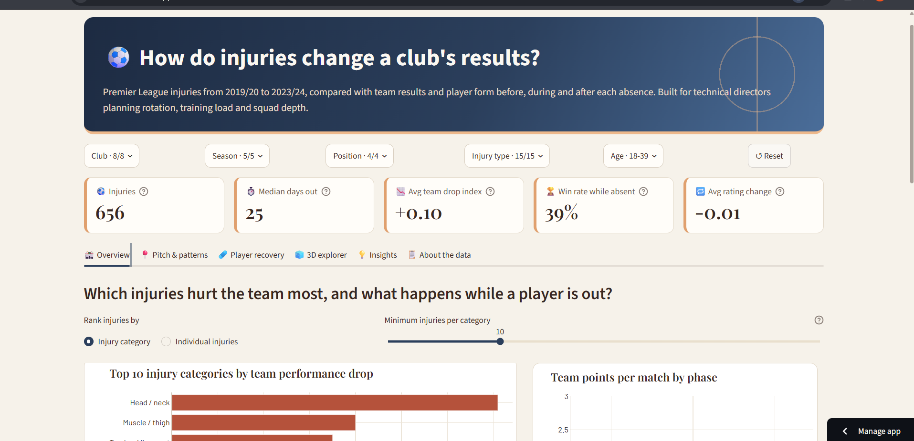
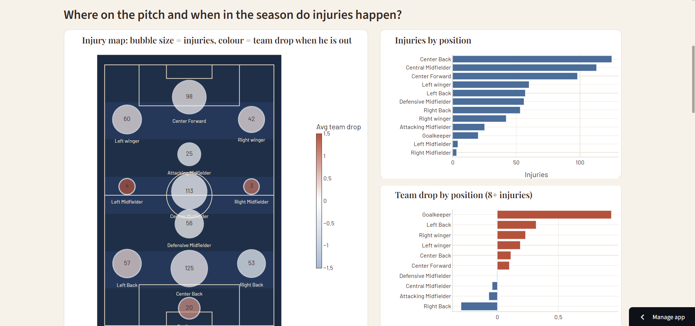
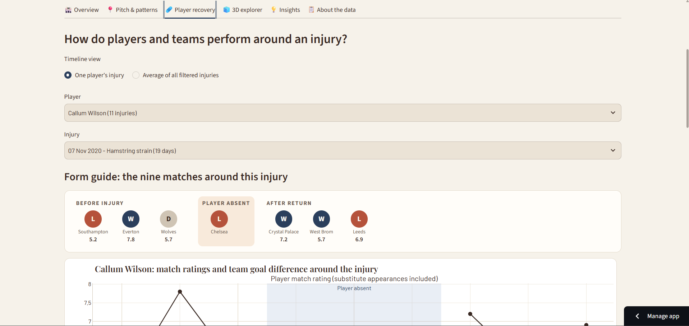
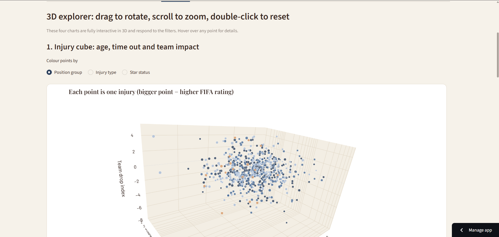
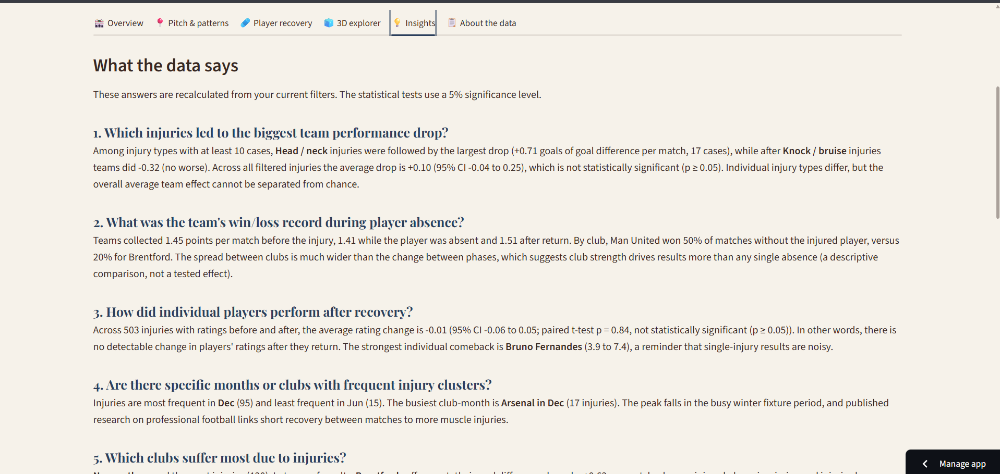

# Player Injuries and Team Performance Dashboard

**Course:** Mathematics for AI-II (Summative Assessment, Scenario 1) | **CRS:** Artificial Intelligence
**Student:** Tanisha Baiju Shukla (ID 2505468)

An interactive Streamlit dashboard for **FootLens Analytics** that shows how player injuries change a football club's results. It is designed for technical directors and sports managers who need data to plan rotation, training load and squad depth.

## Live web app

**Streamlit Cloud link:** [https://footlens.streamlit.app/](https://footlens.streamlit.app/)

## Screenshots

> **Screenshots required.** Take each screenshot from the live app above, save it in the `screenshots/` folder of this repository with exactly the file name shown, and commit it. The images below will then appear automatically.

| Screenshot | Save as | What to capture |
|---|---|---|
| Overview | `screenshots/01_overview.png` | The header, the five KPI cards and the top charts on the Overview tab |
| Pitch and patterns | `screenshots/02_pitch_and_patterns.png` | The football pitch injury map and the club-by-month heatmap |
| Player recovery | `screenshots/03_player_recovery.png` | The form guide, the player timeline and the comeback leaderboard |
| 3D explorer | `screenshots/04_3d_explorer.png` | Any of the rotatable 3D charts |
| Insights | `screenshots/05_insights.png` | The written answers to the research questions and the statistical tables |

| Overview | Pitch and patterns |
|---|---|
|  |  |
| **Player recovery** | **3D explorer** |
|  |  |
| **Insights** | |
|  | |

---

## Project overview

### What the dashboard analyses
The dataset covers **656 injuries to 223 players at 8 Premier League clubs across 5 seasons (2019/20 to 2023/24)**. For every injury it records the three matches before, the three matches missed and the three matches after the player returned (result, opponent, goal difference and, where the player played, a match rating).

The dashboard answers six research questions:

| # | Research question | Where to find it |
|---|---|---|
| 1 | Which injuries led to the biggest team performance drop? | Overview: bar chart |
| 2 | What was the team's win/draw/loss record while the player was absent? | Overview: stacked bar, points per phase |
| 3 | How did individual players perform after recovery? | Player recovery: timeline and leaderboard |
| 4 | Are there specific months or clubs with frequent injury clusters? | Injury patterns: heatmap |
| 5 | Which clubs suffer most due to injuries? | Overview: club chart |
| 6 | Do star players or older players hurt the team more when injured? | Injury patterns: scatter plot and box plot |

### Background research
- Hägglund et al. (2013), *Injuries affect team performance negatively in professional football: an 11-year follow-up of the UEFA Champions League injury study*, British Journal of Sports Medicine. Lower injury burden and higher player availability were linked to better team results, which is why this project compares team results with and without the injured player.
- *Muscle injury rates in professional football increase with fixture congestion*, British Journal of Sports Medicine (2013). Short recovery between matches was linked to more muscle injuries, which motivated the month-by-club analysis.
- Analysts judge team impact with goal difference and points per match, and judge a returning player by match rating, so these are the core metrics.
- Fuller et al. (2006), *Consensus statement on injury definitions and data collection procedures in studies of football (soccer) injuries*, British Journal of Sports Medicine. Injury severity is defined by days absent, which is the basis of the severity bands used here (slight 0-1, minimal 2-3, mild 4-7, moderate 8-28, severe 29+).

### Key features
- **Five required interactive Plotly charts**, plus four extras (see the table below). Every chart has hover details and a one-line caption explaining what it means.
- **Sidebar filters** for club, season, position group, injury type and age. Every chart, KPI and written insight updates with the filters.
- **KPI cards** for injuries, median days out, average team drop index, win rate while absent and average rating change.
- **Insights tab** that writes plain-English answers to all six research questions from the filtered data, with t-tests, a correlation and confidence intervals, plus recommendations and limitations.
- **About tab** that shows the cleaning log, column definitions and sources, and lets users download the filtered data as CSV.
- **Pantone-inspired design:** Dress Blues, Apricot Illusion and Chocolate Fondant on an Alabaster background, with a compact filter bar above the KPI cards so nothing needs scrolling to find.
- **Football pitch injury map:** an interactive pitch showing injuries by position (bubble size = injuries, colour = team drop when the player is out), plus a matching 3D pitch where taller stems mean more injuries.
- **Statistics beyond the basics:** correlation matrix, standardised regression of the team drop, injury-severity analysis, and a robustness table that repeats each t-test with a rank-based test.
- **Conditional insights:** every written conclusion is recalculated from the current filters and worded according to its p-value, so it never claims more than the data shows.
- **Match form guide:** W / D / L chips with opponent and player rating for the nine matches around any injury.
- **3D explorer tab** with three rotatable, zoomable Plotly 3D charts: an injury cube (age, days out and team drop index), a club-by-month injury surface, and a recovery cube (rating before, rating after and days out).
- **Blue-themed design** with a gradient header, KPI cards and a consistent navy, blue and amber palette.
- **Player timeline** showing one injury at a time (or the average of all filtered injuries): match ratings and team goal difference before, during and after the absence.

| Required visual | Chart in the app |
|---|---|
| Bar chart: top 10 injuries with highest team performance drop | Overview tab |
| Line chart: player performance timeline before and after injury | Player recovery tab |
| Heatmap: injury frequency across months and clubs | Pitch & patterns tab |
| Scatter plot: player age vs performance drop index | Pitch & patterns tab |
| Leaderboard table: comeback players ranked by rating improvement | Player recovery tab |

Extra charts: pitch injury map, four 3D charts, points per match by phase, result record while absent, injuries per club, star vs squad box plot and days out by injury type.

### Data preparation (summary)
| Problem found in the raw file | What was done |
|---|---|
| Missing values written as the text `N.A.` (4,784 cells) | Converted to real missing values; never filled with 0 |
| Ratings such as `6.1(S)` (substitute appearances) | Split into a numeric rating and an `is_sub` flag |
| Several date formats and `Present` for players still injured | Flexible date parser; `Present` flagged and excluded from duration |
| Three return dates with year typos (e.g. `Mar 7, 0202`, or a return dated a year before the injury) | Repaired with a simple documented rule |
| 224 raw player names, one repeated with different capitals (`van` vs `Van`) | Names standardised, giving 223 players |
| 103 free-text injury labels with case and spelling variants | Grouped into 15 injury categories |
| Position names with trailing spaces | Trimmed and grouped into Goalkeeper, Defender, Midfielder, Forward |
| 59 matches where result and goal difference disagree | Goal difference set to missing, result kept |

**Engineered columns:** `rating_before`, `rating_after`, `rating_change`, `performance_drop_index` (team goal difference before the injury minus goal difference while the player was absent; above 0 means the team did worse), `points_drop`, `days_out`, `injury_type`, `position_group`, `star_player` (FIFA rating 82 or higher), `injury_month` and `age_group`. The wide table (9 match slots per injury) is also reshaped into a long table (one row per match) for the timeline chart.

### Key findings (full dataset)
- Teams took **1.45 points per match before** an injury and **1.41 while the player was absent**. The average **team performance drop is +0.10 goals per match and is not statistically significant** (p = 0.16). Absences matter, but on average the effect is small.
- Among injury types with at least 10 cases, **head/neck, muscle/thigh and tendon/ligament injuries** show the largest average drops, but the groups are small, so treat them as signals rather than proof.
- **Returning players are rated the same as before** (average change -0.01, p = 0.84).
- **Injuries peak in December** (95) and are lowest in June (15), matching the busiest part of the fixture calendar.
- **Newcastle** have the most injuries (120), but **Brentford and Burnley** see the largest drop in results (+0.62 and +0.51), which suggests thinner squads.
- **Star players are not hit harder** (p = 0.76) and **age is almost unrelated** to the drop (r = 0.03).

### Limitations
Each injury has at most three matches per phase, so averages are noisy. Only eight clubs are included and opponent strength is not controlled for. The analysis shows association, not proof of cause.

---

## Integration details

| Layer | Tool | Role |
|---|---|---|
| Data cleaning | `pandas`, `numpy` (`data_processing.py`) | Load the CSV as text, clean it, engineer features, reshape to long format |
| Statistics | `scipy`, `pandas` (`analysis.py`) | Aggregations (`groupby`, `agg`, `pivot_table`), correlation, t-tests, confidence intervals |
| Visualisation | `plotly` (`app.py`) | Interactive charts with hover, zoom and legend filtering |
| Dashboard | `streamlit` (`app.py`) | Filters, tabs, KPI cards, caching (`st.cache_data`) and CSV download |
| Hosting | GitHub + Streamlit Community Cloud | Cloud installs `requirements.txt` and runs `app.py` straight from the repo |

Data flow: `data/player_injuries_impact.csv` → `get_clean_data()` (cached once per session) → sidebar filters → filtered DataFrames → `analysis.py` functions → Plotly figures and written insights.

### Repository structure
```
├── app.py                      # Streamlit dashboard (main file)
├── data_processing.py          # load_data, clean_data, engineer_features, to_long_format, quality checks
├── analysis.py                 # aggregations and statistical tests
├── requirements.txt            # Python packages
├── README.md
├── .streamlit/config.toml      # colour theme
├── data/player_injuries_impact.csv
├── notebooks/01_injury_impact_eda.ipynb   # Steps 1-3 with outputs
└── screenshots/                # images used in this README
```

## Deployment instructions

### Run locally
```bash
git clone https://github.com/<your-username>/<repo-name>.git
cd <repo-name>
python -m venv .venv && source .venv/bin/activate    # Windows: .venv\Scripts\activate
pip install -r requirements.txt
streamlit run app.py
```
The app opens at `http://localhost:8501`.

### Deploy to Streamlit Community Cloud
1. Push this folder to a public GitHub repository (keep `app.py`, `requirements.txt` and the `data/` folder at the top level).
2. Go to [share.streamlit.io](https://share.streamlit.io) and sign in with GitHub.
3. Click **Create app** (or **Deploy an app**), choose the repository, branch `main` and main file path `app.py`.
4. Click **Deploy**. The first build installs the packages in `requirements.txt` and takes a couple of minutes.
5. Copy the app URL and paste it into the **Live web app** section at the top of this README.

### Explore the analysis
Open `notebooks/01_injury_impact_eda.ipynb` for the research questions, cleaning steps, `groupby`/`pivot_table` analysis and hypothesis tests with their outputs.
